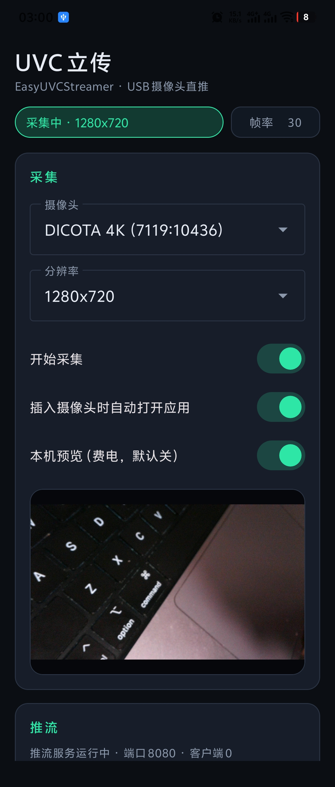
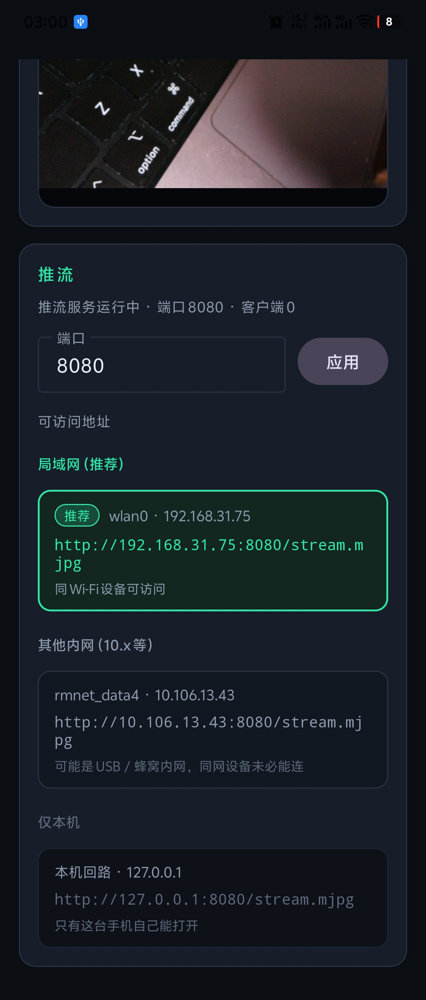

# EasyUVCStreamer（UVC 立传）

用 Android 手机当 USB Host，把 UVC 摄像头的 **原始 MJPEG** 低延迟推到局域网。

桌面显示名：**UVC 立传** · 工程名：**EasyUVCStreamer**

<p align="center">
  
  
</p>

## 能做什么

- 枚举 / 打开 USB UVC 设备，协商 MJPEG 分辨率并开流
- **同时采集两路摄像头**（每路一个独立的 USB 句柄、分辨率/帧率、状态机）
- **每路一个独立 HTTP MJPEG 端口**（`multipart/x-mixed-replace`），两路互不影响，可分别被多台设备访问
- **Cymple 直连**：按 Cymple 的 DIY 摄像头协议（UDP 23302 / 23303，320×240 灰度 JPEG 分片）把画面直接发给电脑端 Cymple 软件，做眼追 / 面捕
- 启动后自动开 HTTP 服务；每路端口可单独修改；按网卡列出可访问地址（点按复制）
- 本机预览默认关闭（避免解码费电）；两路都可单独打开
- 可选：插入摄像头时由系统唤起 App 并尝试开流

主线不做转码：摄像头 → 原始 JPEG → 网络。没有订阅客户端时，采集回调里尽量不额外拷贝帧；两路的 YUV→JPEG 编码各自使用独立的线程内压缩器，互不排队。

## 环境要求

- Android **8.0+**（`minSdk 28`），设备需支持 **USB Host**
- Android Studio + NDK（可通过 `ANDROID_NDK_HOME` 指定路径）
- [vcpkg](https://vcpkg.io/)，并设置环境变量 `VCPKG_ROOT`（未设置时默认 `~/vcpkg`）

Native 依赖（manifest 模式，构建时自动拉取）：

- libusb / libuvc（含 Android isoch 相关 overlay）
- libhv（HTTP 服务）

## 构建

```bash
# 确认 VCPKG_ROOT
echo $VCPKG_ROOT

# Android Studio 打开工程，或：
./gradlew :app:assembleDebug
```

CI 或自定义环境可通过 `ANDROID_NDK_HOME` 指定 NDK 路径。

ABI：`arm64-v8a`、`x86_64`。

### GitHub Release

发布 GitHub Release 后，Actions 会从 Release Tag（如 `v1.2.3`）读取 `versionName`，调用
`scripts/build-release.sh` 构建，并把 APK 上传到该 Release。仓库需要配置以下 Actions Secrets：

- `RELEASE_KEYSTORE_BASE64`：release keystore 的 Base64 内容
- `RELEASE_STORE_PASSWORD`
- `RELEASE_KEY_ALIAS`
- `RELEASE_KEY_PASSWORD`

## 使用

1. 授权 USB 摄像头 / 录音（部分机型插 UVC 会提示麦克风；视频主线仍可用）
2. 插入 UVC 摄像头并授予 USB 权限
3. 在「摄像头 1」/「摄像头 2」卡片里分别选择设备、分辨率、帧率，打开各自的「开始采集」
4. 在「推流」区查看两路地址，例如：

   - 摄像头 1：`http://<手机局域网IP>:8080/stream.mjpg`
   - 摄像头 2：`http://<手机局域网IP>:8081/stream.mjpg`

5. 同网电脑用浏览器、VLC 等分别打开上述 URL 即可看到两路画面

两路端口互相独立（默认 8080 / 8081），可在各自端口框里单独修改。每路也可以单独配置：

- 页面：`http://<IP>:<端口>/`（该路的简单预览页）
- 状态：`http://<IP>:<端口>/status`（JSON，含 `camera` 路号）

注意：同一台摄像头不能被两路同时占用；在另一路的下拉框里选中正在使用的设备会提示「该摄像头已被另一路使用」。

### Cymple 直连（眼追 / 面捕）

把手机画面当作 Cymple 的 “DIY 摄像头” 直接发送给电脑端 Cymple 软件，不需要虚拟摄像头驱动：

1. 电脑端打开 Cymple，Start 页开启 **CympleFace**；
2. 手机与电脑连同一个 Wi-Fi；
3. App 里打开「Cymple 直连」开关，状态显示「已连接 Cymple：&lt;IP&gt; · N fps」即成功；
4. 在「位置」下拉里给两路摄像头指定 左眼 / 右眼 / 嘴部 / 不发送。

协议要点（实现见 `app/src/main/java/com/omoai/simpleuvcstreamer/cymple/`）：

- Cymple（PC）向 UDP **23302** 广播心跳（TLV `type=0/4`），本端记录来源 IP；
- 本端把每路画面缩放到 **320×240 灰度** JPEG，按 TLV `type=5`（`MSG_IMAGE_V2_E`）分片（每片 ≤1444 字节，含 offset/total/len/位置旗标/frameIndex）发往 **PC:23303**；
- 5 秒收不到心跳自动停发；位置旗标：0=左眼、1=右眼、2=嘴部。

## 结构概览

```
app/src/main/
  java/.../          # UI、USB、会话、HTTP 控制器
  java/.../cymple/   # Cymple DIY 摄像头协议直连
  cpp/               # JNI、libuvc 采集、帧管线、libhv MJPEG 服务
  cpp/overlay-ports/ # libuvc Android 补丁（iso transfer 等）
images/              # 截图
```

## 许可

本项目以 [AGPL-3.0](LICENSE) 发布。若你基于本项目提供网络服务，需遵守 AGPL 对源码公开的要求。
